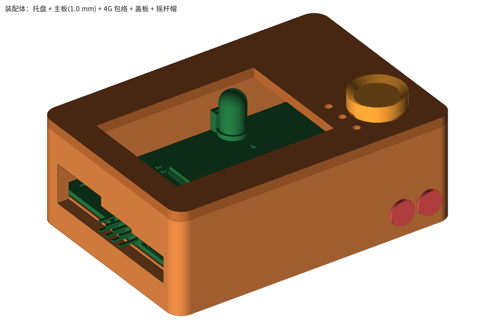
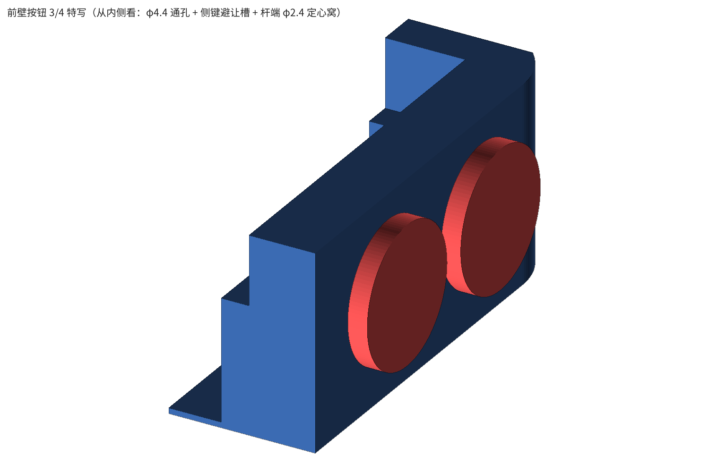
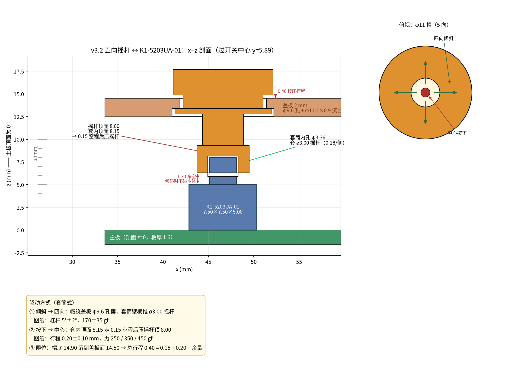
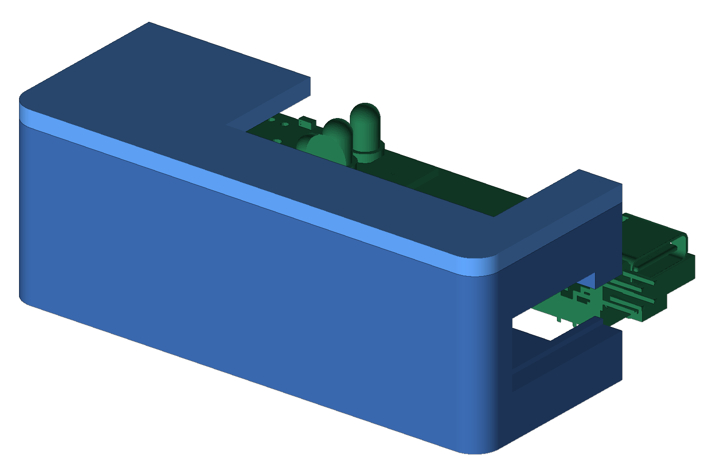

# 上层主板外壳 · 3D 打印件（v3.4）

给这块 **STM32F429/F407 + SH1106 + 4G + 五向键** 的迷你开发板**上层主板**做的可打印外壳：
托盘（封闭底）+ 盖板 + 套筒式五向摇杆帽 + **两个独立的 RESET / POWER 按钮件**。
只做上层板，主板仍可用原来的 25 针排针插回下层通讯板。

> 板子外形 **53.70 × 35.19 mm**，四角直角，**板厚 1.0 mm**（实测）。
> 板框/元件位置全部来自项目自带的 3D 模型逐件标定（见 §7），不是按照片猜的。

```
外形        59.20 × 41.54 mm        总高 21.50（到底板）／24.70（含摇杆帽）
壁厚 2.4    底板 1.6    顶板 2.0    转角 R3.0
```



---

## 1. 零件（共 5 件：托盘 1 + 盖板 1 + 摇杆帽 1 + 按钮 2）

| 件 | 外形 (mm) | 体积 (mm³) | 文件 |
|---|---|---|---|
| 托盘 tray（封闭底 + 2 个按钮孔） | 59.20 × 41.54 × 19.50 | 12189.8 | `stl/stm32f429_tray.stl` · `step/` |
| 盖板 lid | 59.20 × 41.54 × 3.30 | 3271.5 | `stl/stm32f429_lid.stl` · `step/` |
| 摇杆帽 joystick | 10.99 × 11.00 × 11.40 | 450.8 | `stl/stm32f429_joystick.stl` · `step/` |
| **按钮 button（打 2 个）** | 5.00 × 3.35 × 5.00 | 46.1 | `stl/stm32f429_button.stl` · `step/` |
| 装配体 | 59.20 × 41.54 × 21.50（含帽 24.70） | — | `step/stm32f429_assy.step` |

整装文件（含**真实主板网格**，可直接在切片/查看器里对位）：

| 文件 | 内容 |
|---|---|
| `3mf/stm32f429_assy_full.3mf` | 托盘 + 主板 + 4G 包络 + 盖板 + 摇杆帽 + 两个按钮（6 对象带颜色，2.1 MB） |
| `step/stm32f429_assy_full.step` | 同上，主板按 1.0 mm 平板 + 4G 盒（CAD 装配，0.6 MB） |

### 1.1 板上三个按键，分别是什么形态

| 板上按键 | 开关 | 外壳上的零件 | 位置 |
|---|---|---|---|
| 五向键（上下左右 + 中心按下） | SW1 `K1-5203UA-01` | **摇杆帽**（φ11 帽 + 套筒 + 挤入式卡爪，一件搞定五向） | 顶板 (46.60, 5.89) |
| RESET | SW2 侧键 | **按钮件**（φ5.00 帽 + φ4.00 杆），打 2 个装前壁 | 前壁 x 45.03 |
| 启动（BOOT/POWER） | SW3 侧键 | 同上，同一个 STL，左右通用 | 前壁 x 50.88 |

**按钮不是「只给个洞」**：托盘上只有 φ4.40 的孔，按钮是**另外打印的件**（一次打两个，通用不需镜像）。
帽 φ5.00 比孔大 → 从外侧插上去就卡在墙面，掉不进壳里；杆穿进墙内、端面停在开关弹片前 0.09 mm，
所以按压行程 = 0.09 空程 + 0.20 开关行程 = **0.29 mm**，松手由开关自己的弹片顶回来。
单独看 `stl/stm32f429_tray.stl` 当然只有洞 —— 想看「三个按键全装上」的样子，开 `3mf/stm32f429_assy_full.3mf`。

---

## 2. 关键尺寸与开孔

**坐标约定**（与板模型同手系）：俯视 **x 向右、y 向上**；`y = 0` 是 RESET / POWER 侧键那条板边，
`y = 35.19` 是 RGB 灯的对边；**USB-A / 烧录口 / TYPE-C 三窗在 x ≈ 0 的左壁**。
摆出来就是：USB 在左，LED + 摇杆 + 两个按钮在右下 —— 与实物完全一致。

| 面 | 开孔 |
|---|---|
| 左壁（x−） | **USB-A** `y 19.49..32.79`、顶 6.50 ／ **CN1 烧录口 2×4P 2.0** `y 10.29..19.49`、顶 4.60 ／ **TYPE-C** `y 0.49..10.29`、顶 3.80 —— 三窗一体阶梯，窗底都在 z −1.60 |
| 前壁（y−） | 两个 **φ4.40 按钮孔** @ x 45.03 / 50.88, z −1.90；墙内 per-switch 避让槽（台面以下） |
| 顶板 | **OLED 窗 33.6 × 24.6 直角** @ (19.44, 16.50)；**3 × φ1.5 LED 孔** @ x 39.59 / y 10.72·6.53·2.17（内面 φ4.0 喇叭口）；**摇杆座 φ9.6** @ (46.60, 5.89) + 内面 φ11.2 × 0.9 沉台 |
| 右壁 / 后壁 | **完全封闭**（按需求不开 SIM / TF 槽；RGB 灯也不开孔，顶 8.70 距内表面 12.5 余 3.8） |

---

## 3. 三个部件怎么设计

### 3.1 托盘：封闭底 + 台面 + 阶梯三窗

- 底板 1.6 mm，四壁 2.4 mm，转角 R3.0（与板角一致）。
- **台面 z = −1.00，宽 1.0 mm**：板四边落在这里，台面正下方是实心立柱（不是悬臂），承重直接走到底板。
- 下腔 z −5.40 … −1.00（**净深 4.40**）：留给背面 4G 模块（2.4）和侧键（1.80）。实测最深的背面元件只有 −3.01。
- 三窗故意**不留薄肋**：USB-A / CN1 / TYPE-C 之间只有 0.9 mm 间距，留肋会是 0.3 mm 薄片，必断。

### 3.2 侧键按钮（v3.4 重做，原来是硬伤）

RESET / POWER 是贴在后板面的两个 **K1-5203UA-01 五脚侧键**（本体 4.60 × 3.55 × 1.80，外表面伸出板边 0.86）。

上一版在墙上留了 0.60 mm「柔性皮」：5.3 × 2.65 的窗口四周全粘住 = 四边固支薄板，
`k ≈ 3EI/L³ ≈ 185 ~ 2900 N/mm`，压下 0.25 mm 要 **50 ~ 700 N** —— 手指按不动。

现在是**独立按钮件**，并且让**开关自己的弹片当定位弹簧**：

```
托盘   避让槽  每键 x 中心 ±2.40、y 34.60..36.15、z −3.30..−1.00（只挖台面以下，台面照旧承板）
       按钮孔  φ4.40 通孔 @ (45.03 / 50.88, z −1.90)
按钮   杆 φ4.00   y 36.14..38.79   单边 0.20 间隙
       帽 φ5.00×0.70  y 38.79..39.49   比孔大 → 掉不进壳里
行程   0.09 空程（杆端 36.14 ↔ 侧键面 36.05）+ 0.20 开关行程 = 0.29 mm，回弹全靠开关弹片
```

不做卡扣 / 活铰链的原因：墙只有 2.59 ~ 2.64 mm，开关背后 0.15 内没有空间；PLA 卡扣要 100 N 级才能压进去。
**这个尺寸的刚性件里做不出「橡胶感」**，所以把定位交给开关弹片（图纸 lever 170 ± 35 gf）。



### 3.3 盖板：定位唇 + 摩擦筋（不用卡扣）

- 顶板 2.0 mm，轮廓与托盘同（59.20 × 41.54，R3）。
- **1.2 mm 定位唇**高 1.3（z 11.20…12.50），外表面比内腔缩进 0.15，下端 0.9 做 45° 导入斜面。
- 四边各 2 条 **6 × 1.2 mm 摩擦筋**，与内壁齐平（名义零过盈），靠打印公差产生摩擦 → 可反复拆装。
- 不用卡扣：1.2 mm 环形凸缘要在 0.15 mm 内产生弹性，PLA 需要 ~12% 应变，必然开裂。

### 3.4 五向摇杆帽：套筒式驱动 + 挤入式卡爪



开关是 **K1-5203UA-01**：本体 7.50 × 7.50 × 5.00，**摇杆 ø3.00、顶面在板面上 8.00**，
四向倾斜 5° ± 2°（170 ± 35 gf），中心按下 0.20 ± 0.1 mm（250 / 350 / 450 gf）。

```
套筒   外 φ5.76（壁 1.2）  z 6.30..9.35    内孔 φ3.36 套住 ø3.00 摇杆（单边 0.18）
套内顶 内孔 φ3.36          z 8.15          摇杆顶 8.00 → 先走 0.15 空程
杆     φ4.50               z 9.35..14.90
颈     φ8.8                z 13.40..14.90  在 φ9.6 孔里，径向余 0.4
卡爪   φ10.6               z 12.80..13.40  比孔大 1.0，3 条 0.9 竖槽压缩后挤过 φ9.6
帽     φ11                 z 14.90..17.70  顶面 0.8 收口 + φ3.2 指窝
```

- **四向**：倾斜帽 → 套筒壁横推摇杆（套筒内孔留 0.18 单边间隙，可晃 ±2.8°）。
- **按下**：套内顶面 z 8.15 先走 0.15 空程，再压摇杆顶面 → 开关走完 0.20 行程。
- **限位**：帽底 14.90 落到盖板面 14.50 → 总行程 0.40 mm，不会压坏开关。
- 帽半径上限 5.42（受中间那颗 LED 孔限制，最小间距 7.02）。

---

## 4. 装配

1. **先装按钮**：从托盘外侧把 φ4.0 杆插进 φ4.4 孔，帽落在墙面即可（不用胶、不用卡扣）。
2. 主板**正面朝上**放进托盘：先把侧键那侧斜插进避让槽，再整片压下 —— 板四边落进 1.0 mm 台面。
   侧键被推进避让槽后正好顶住按钮杆（0.09 间隙）。
3. 检查：左侧三窗对齐；按两下按钮，应有 0.29 mm 行程、轻响、回弹。
4. 盖板对齐后**从上方平压**：定位唇先入，摩擦筋逐条贴合，压到盖板下沿贴住托盘上口（z 12.5）。
5. 把摇杆帽压进 φ9.6 座，「咔」一声卡住；空按几次确认四向与中心。
6. 拆：从 z 12.5 分模线四角轮流轻撬；摇杆帽和按钮不用拆。



---

## 5. 打印

| 件 | 摆向 | 支撑 | 参数 |
|---|---|---|---|
| 托盘 | 底面朝下（按模型方向） | **不需要** | 0.2 层高 / 0.4 喷嘴 / 3 周壁 / 15% 网格 |
| 盖板 | **顶面朝下**（屏窗那面贴平台） | 不需要 | 同上，顶层 4 层让顶板平整 |
| 摇杆帽 | **套筒口朝下**（z 6.30 面贴平台） | 不需要（帽底 φ11 悬在 φ8.8 颈上，1.1 mm 环会桥接） | 0.16 层高 / 3 周壁 / **勿 100% 填充**（卡爪要弹性）；套筒内孔开「孔洞补偿」 |
| 按钮 ×2 | **帽面朝下**（φ5 帽贴平台，杆朝上） | 不需要 | 0.16 层高，开「孔洞补偿」，两个一起打 |

PLA 可用；PETG 韧性更好，卡爪和按钮反复拆装更耐用。
公差 ±0.15 会让摩擦筋偏紧或偏松：偏紧直接压入（PLA 微量屈服），偏松贴一层美纹纸。

---

## 6. 自检结果（可复现）

| 项 | 结果 |
|---|---|
| 结构探针 `src/verify_case.py` | **79 / 79 通过**（0.24 mm 立方探针 ∩ 实体） |
| 件间干涉（9 组） | tray / lid / joystick / button 两两 **全部 0.0000 mm³** |
| 开关包络 | 本体 7.5×7.5×5.00 + ø3.00 摇杆到 8.00 ∩ tray / lid / joy = **0.0000 mm³** |
| 侧键包络 | 4.60×3.55×1.80 ∩ tray / button = **0.0000 mm³** |
| 4G 包络 | 26×26×2.4 在板下任意位置扫掠 ∩ tray / lid = **0.0000 mm³** |
| 真实 PCB 装入 `src/fit_check.py` | 0.10 mm 光栅化逐格判撞：**无干涉**；顶面最高 8.70（余 3.80）、底面真实最深 −3.01（余 2.39）、CN1 外伸至 x −4.25 穿窗露出 1.50 |
| STL 校验 `src/check_stl.py` | 四件全部闭合（非 2 度边 = 0），体积与 STEP 一致：12189.8 / 3271.5 / 450.8 / 46.1 mm³ |

剖面图（带 mm 刻度）与多视角渲染见 `previews/`。

---

## 7. 这是怎么来的（数据来源）

板框、元件位置、元件高度全部从项目提供的 **`pcb3d.obj`（114521 顶点 / 227394 三角面 / 233 个连通分量）** 标定：

- 单位标定：LQFP-100 本体 55.10 unit = 14.00 mm → **0.254 mm/unit（10 mil）**。
- 板框 = **53.70 × 35.19 mm、四角直角**；模型里板厚画成 2.54，真实板厚按实测 **1.0** 重映射。
- 元件逐个连通分量识别：USB-C / CN1 弯针 / 3× φ3 直插 LED / φ5 RGB / 背面 RESET·POWER 侧键 / W25Q256 …
- OBJ 里**没有** 3D 模型的器件（USB-A、SD 卡座、五向键、蜂鸣器、OLED 排母、ESP-12E、EC600S）
  用板上丝印/焊盘尺寸 + 厂商图纸补齐，五向键与侧键用 K1-5203UA-01 图纸。

`src/` 里的脚本按这个顺序跑即可重新生成全部文件（`pcb3d.obj` 因体积未入库，
需要时从上游 OSHWHub 工程取，或直接融化现成 STL/STEP）。

```bash
cd hardware/enclosure
python src/build_case.py      # 建模 + 导出 STL/STEP/装配（约 40 s）
python src/verify_case.py     # 79/79 探针
python src/check_stl.py       # STL 闭合/体积
python src/sections.py        # 7 张 mm 刻度剖面
python src/render_zbuf.py     # 15 张视图
python src/build_assy.py      # 整装 3MF + STEP
python src/render_assy.py     # 整装预览 + 2D 堆叠剖面
# 需要 pcb3d.obj 的：
python src/fit_check.py       # 真实 PCB 装入自检
python src/render_fit.py      # 真实 PCB 半剖装入图
```

依赖：Python 3.10+、`cadquery`、`numpy`、`matplotlib`（作者用 `/home/lshan/.venv-cad`）。

---

## 8. 已知风险

| 项 | 现状 | 万一不合怎么办 |
|---|---|---|
| **OLED 屏窗位置** | 玻璃 33.6 × 24.6 的尺寸由模块实物照片标定（可靠），位置从照片反算，y 向不确定度约 ±0.7 | 偏了用刀修窗边，或改 `OLED_CX/OLED_CY` 只重打盖板 |
| **OLED 模块高度** | OBJ 无该件模型，按 7P 排母 8.5 + 模块 PCB 1.2 + 玻璃 1.6 ≈ 11.3，顶板内表面 12.5，余 1.2 | 换矮排母，或台面垫 0.5/1 mm 垫片 |
| 侧键手感 | 刚性传动，行程 0.09 + 0.20，回弹靠开关弹片 | 按不到 → `BTN_END` 36.14 改 36.09；装不进 → `BTN_HOLE_R` 2.20 改 2.30 |
| 按钮在裸托盘里是活的 | 帽比孔大不会掉进壳里，但能自由晃 | 属正常；装上主板后由侧键弹片顶住 |
| 套筒内孔 φ3.36 | FDM 收缩会让孔变小 | 装不进先用 ø3 钻头过一遍，或 `JOY_SOCK_R` 1.68 → 1.75 重打 |
| 摇杆空程 | 套内顶 8.15 比摇杆顶 8.00 高 0.15 | 按下去没反应 → `JOY_SOCK_CEIL` 降 8.05；一装上就半按 → 抬 8.20 |
| 盖板保持力 | 摩擦筋零过盈 | 松了贴美纹纸，紧了撬大一点 |
| 板厚 | 按实测 1.0 建模 | 换 1.2/1.6 板只改 `BT`，板底/台面/侧键/避让槽全部自动跟随 |

**没做**：螺钉/铜柱（板上四角都被元件占了）、防水、Type-C 独立通道（与 A 口共用一窗）。

---

## 9. 来源与许可

- 开发板：OSHWHub 工程 `Angle_145/stm32f429vet6_copy_copy`（「stm32f429 mini版 4G物联网开发板」，MIT），
  上板由 U1 STM32F429VET6 + U6 EC600S(4G) + U4 ESP-12E + U2 OLED 1.3" + USB-A / TYPE-C + TF + 五向键 + 锂电充电组成。
- 五向键 / 侧键：HRO ELECTRONICS **K1-5203UA-01** 厂商图纸（本体 7.50×7.50×5.00、摇杆 ø3.00 顶面 8.00）。
- 外壳模型与脚本：本目录，随本仓库一起以 **Apache-2.0** 发布（同仓库 `LICENSE`）。
